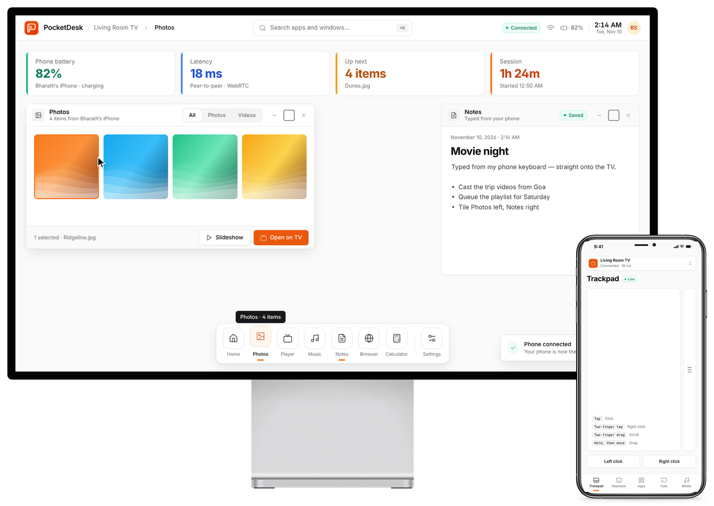

<div align="center">


# PocketDesk

**Your phone is the remote. Your TV is the desktop.**

PocketDesk turns any TV with a web browser into a desktop with windows and a dock.
Your Android phone or iPhone becomes its trackpad, keyboard and casting remote. Nothing to install.

[**Live app**](https://pocketdesk-pi.vercel.app) · [Live demo](https://pocketdesk-pi.vercel.app/demo) · [Report a bug](https://github.com/Bharathshiva24/pocketdesk/issues)

[](LICENSE)





</div>

## Features

- **Desktop on the TV.** Windows you can move, resize and snap left/right, tile everything at once, and switch between from a dock. There's also a ⌘K-style launcher, right-click menus and status cards for battery, latency, queue and session time.
- **Trackpad and gestures.** Tap to click, two fingers to right-click or scroll, hold then drag to move windows.
- **Your phone's keyboard.** Type into any field on the TV, with autocorrect and dictation included.
- **Cast photos, video and music.** Files go straight from your phone to the TV, with play/pause, seek, ±10 s, next/previous and volume control.
- **Built-in apps.** Photos, Player, Music, Notes, Browser, Calculator and Settings.
- **Peer-to-peer.** Phone and TV talk directly over WebRTC, so your files never touch a server.
- **Works everywhere.** Samsung (Tizen), LG (webOS), Android/Google TV, Fire TV, or any computer plugged into the TV over HDMI. The TV remote's arrow keys move the pointer and OK clicks.

## Quick start

### Use the hosted version

1. On the TV, open **pocketdesk-pi.vercel.app/tv** in its web browser.
2. On your phone, scan the QR code with the camera, or open **pocketdesk-pi.vercel.app/phone** and enter the 6-digit code.
3. That's it. Add the phone page to your home screen for an app-like experience.

> Want to look around first? The [live demo](https://pocketdesk-pi.vercel.app/demo) puts a TV and a phone side by side in one browser window.

### Run it yourself

```bash
git clone https://github.com/Bharathshiva24/pocketdesk.git
cd pocketdesk
npm install
npm start
```

The server prints a LAN address such as `http://192.168.1.20:8080`. Open `/tv` on the TV and scan the QR code. In this mode, pairing and input go through your own server over WebSocket, and media streams from it with seeking support. Nothing leaves your network.

### Deploy your own copy

The `public/` folder is a complete static site. On Vercel, import the repository and deploy; `vercel.json` already sets everything up. It works the same on Netlify, Cloudflare Pages or GitHub Pages: publish `public/` with "clean URLs" turned on.

[](https://vercel.com/new/clone?repository-url=https%3A%2F%2Fgithub.com%2FBharathshiva24%2Fpocketdesk)

## How it works

```
 ┌──────────── TV (any browser) ────────────┐                   ┌─── Phone (any browser) ───┐
 │  /tv — windows · dock · launcher · apps  │ ◀── WebRTC data ─▶ │  /phone — trackpad · keys │
 │  virtual pointer · media player · QR     │      channel       │  apps · cast · media      │
 └───────────────────────▲──────────────────┘                    └────────────▲──────────────┘
                         └──────── PeerJS signalling (pairing code) ─────────┘
```

- **Hosted / static mode (default).** The TV registers a peer ID derived from its 6-digit code. The phone dials it, and once connected all input and files flow directly over an encrypted WebRTC data channel.
- **Self-hosted mode.** When `/api/info` responds (i.e. `npm start`), both sides use the bundled server over WebSocket instead. Force either mode with `?mode=p2p` or `?mode=server`.
- **Input.** The phone sends relative pointer moves, clicks, scrolls, text and keys. The TV moves a virtual cursor on a fixed 1920×1080 canvas, scaled to the screen, and dispatches real pointer events, so every app works with a phone, a TV remote or a plugged-in mouse.

<details>
<summary><b>Message protocol</b></summary>

| From | Message | Meaning |
|---|---|---|
| TV | `host` → `hosted {code}` | Register and get a pairing code |
| Phone | `join {code, device}` → `joined` | Pair with the TV |
| Phone | `move {dx, dy}` · `down` / `up` · `click {button}` · `scroll {dy}` | Pointer |
| Phone | `text {text}` · `key {key}` | Keyboard |
| Phone | `open {app, payload}` · `action {action}` · `cast {item}` · `media {action, value}` | Commands |
| Both | `ping {ts}` → `pong {ts}` | Latency |
| TV | `tv-info {name}` · `media-state {...}` · `kbd-hint {field}` | Feedback to the phone |

</details>

## Project structure

```
public/            The app: static, no build step
  index.html       Landing page
  tv.html          TV desktop        → js/tv.js,    css/tv.css
  phone.html       Phone controller  → js/phone.js, css/phone.css
  demo.html        TV + phone in one page (in-memory link)
  js/transport.js  WebSocket, WebRTC (PeerJS) and in-page transports
  js/icons.js      Lucide icons and the app catalogue
  vendor/          PeerJS and QR code generator (browser builds)
server/index.js    Optional self-hosted server
tests/             node:test integration tests
tools/             Vendoring and single-file demo bundler
docs/images/       Screenshots
```

## Limitations

- **Your phone's own apps.** A web app can't show other phone apps on the TV. PocketDesk runs its own apps on the TV and uses your phone as the controller. Mirroring Android apps would need a native Android app; iOS doesn't allow it for third-party apps.
- **Restrictive networks.** A few corporate or mobile networks block peer-to-peer connections. Use the self-hosted mode there.
- **Embedded websites.** Many sites refuse to be shown inside another page, so they'll appear blank in the Browser app.
- **Secure context features.** Screen wake lock and battery level need HTTPS. They work on the hosted version, and quietly switch off on a plain-HTTP LAN server.

## Contributing

Contributions are welcome. See [CONTRIBUTING.md](CONTRIBUTING.md). Run `npm test` before opening a pull request.

## Credits

[Lucide](https://lucide.dev) icons (ISC) · [Geist](https://vercel.com/font) typeface (OFL) · [PeerJS](https://peerjs.com) (MIT) · [qrcode-generator](https://github.com/kazuhikoarase/qrcode-generator) (MIT) · design language inspired by [shadcn/ui](https://ui.shadcn.com) and [Creative Tim UI](https://www.creative-tim.com/ui).

## License

[MIT](LICENSE) © 2026 Bharath Shiva
