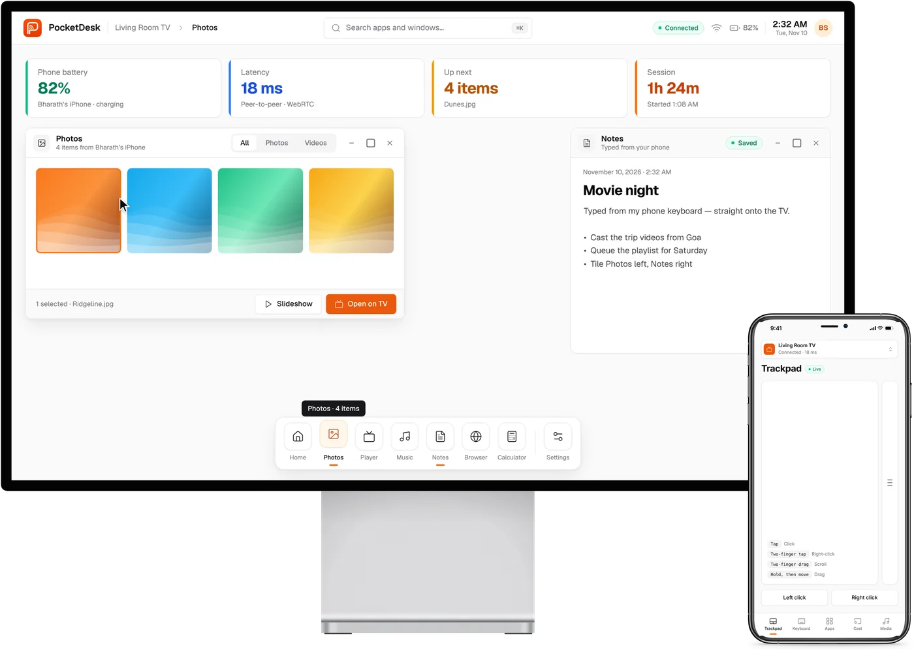
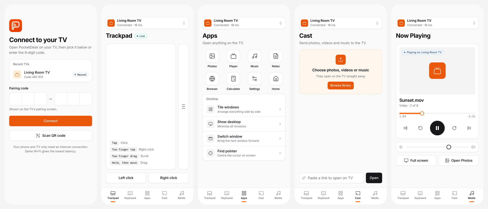

<div align="center">


# PocketDesk

**Your phone is your PC. Plug in and get to work.**

PocketDesk turns your Android phone into a desktop-style workspace.
Connect it to any monitor or TV and get windows, a dock and a full desktop on the big screen, with your phone as the trackpad and keyboard.

[**Download for Android**](https://github.com/Bharathshiva24/pocketdesk/releases/latest/download/PocketDesk.apk) · [Website](https://getpocketdesk.vercel.app) · [Live demo](https://getpocketdesk.vercel.app/demo) · [Report a bug](https://github.com/Bharathshiva24/pocketdesk/issues)

[](LICENSE)






</div>

## Features

- **Mobile to desktop.** Your phone runs a desktop-style workspace on the big screen: windows you can move, resize, snap and tile, a dock, a ⌘K-style launcher and right-click menus.
- **Connect to any display.** Plug into a monitor, TV or projector over USB‑C or HDMI. No smart TV, Wi‑Fi or internet needed. See [Wired mode](docs/WIRED.md).
- **Your phone is the trackpad and keyboard.** Tap to click, two fingers to right-click or scroll, hold then drag to move windows, and type with your phone's keyboard, including autocorrect and dictation.
- **Ready to work.** Built-in Notes, Browser, Photos, Player, Music, Calculator and Settings.
- **Android first.** A free APK for Android today. iPhone support is in progress.
- **Wireless too.** No cable? Open the web version on any smart TV or computer and pair your phone (Android or iPhone) with a QR code. Phone and display talk directly over WebRTC.

## Quick start

### Android (recommended)

1. [Download **PocketDesk.apk**](https://github.com/Bharathshiva24/pocketdesk/releases/latest/download/PocketDesk.apk) on your Android phone and open it. Allow "Install unknown apps" when asked.
2. Connect your phone to a monitor or TV with a USB‑C → HDMI cable or adapter, and choose that input on the display.
3. The desktop appears on the big screen. Use your phone as the trackpad and keyboard.

Your phone needs USB‑C video out (DisplayPort Alt Mode). Check the [compatibility list](docs/WIRED.md#compatibility), or use wireless mode below.

### Wireless (any smart TV or computer)

1. On the display, open **getpocketdesk.vercel.app/tv** in its web browser.
2. On your phone, scan the QR code with the camera, or open **getpocketdesk.vercel.app/phone** and enter the 6-digit code.

> Want to look around first? The [live demo](https://getpocketdesk.vercel.app/demo) puts a display and a phone side by side in one browser window.

### Run it yourself

```bash
git clone https://github.com/Bharathshiva24/pocketdesk.git
cd pocketdesk
npm install
npm start
```

The server prints a LAN address such as `http://192.168.1.20:8080`. Open `/tv` on the TV and scan the QR code. In this mode, pairing and input go through your own server over WebSocket, and media streams from it with seeking support. Nothing leaves your network.

### Deploy your own copy

The `public/` folder is a complete static site. On Vercel, import the repository and deploy; `vercel.json` already sets everything up. It works the same on Netlify, Cloudflare Pages or GitHub Pages: publish `public/` with "clean URLs" turned on.

[](https://vercel.com/new/clone?repository-url=https%3A%2F%2Fgithub.com%2FBharathshiva24%2Fpocketdesk)

## How it works

```
 ┌──────────── TV (any browser) ────────────┐                   ┌─── Phone (any browser) ───┐
 │  /tv — windows · dock · launcher · apps  │ ◀── WebRTC data ─▶ │  /phone — trackpad · keys │
 │  virtual pointer · media player · QR     │      channel       │  apps · cast · media      │
 └───────────────────────▲──────────────────┘                    └────────────▲──────────────┘
                         └──────── PeerJS signalling (pairing code) ─────────┘
```

- **Hosted / static mode (default).** The TV registers a peer ID derived from its 6-digit code. The phone dials it, and once connected all input and files flow directly over an encrypted WebRTC data channel.
- **Self-hosted mode.** When `/api/info` responds (i.e. `npm start`), both sides use the bundled server over WebSocket instead. Force either mode with `?mode=p2p` or `?mode=server`.
- **Input.** The phone sends relative pointer moves, clicks, scrolls, text and keys. The TV moves a virtual cursor on a fixed 1920×1080 canvas, scaled to the screen, and dispatches real pointer events, so every app works with a phone, a TV remote or a plugged-in mouse.

<details>
<summary><b>Message protocol</b></summary>

| From | Message | Meaning |
|---|---|---|
| TV | `host` → `hosted {code}` | Register and get a pairing code |
| Phone | `join {code, device}` → `joined` | Pair with the TV |
| Phone | `move {dx, dy}` · `down` / `up` · `click {button}` · `scroll {dy}` | Pointer |
| Phone | `text {text}` · `key {key}` | Keyboard |
| Phone | `open {app, payload}` · `action {action}` · `cast {item}` · `media {action, value}` | Commands |
| Both | `ping {ts}` → `pong {ts}` | Latency |
| TV | `tv-info {name}` · `media-state {...}` · `kbd-hint {field}` | Feedback to the phone |

</details>

## Project structure

```
public/            The app: static, no build step
  index.html       Landing page
  tv.html          TV desktop        → js/tv.js,    css/tv.css
  phone.html       Phone controller  → js/phone.js, css/phone.css
  demo.html        TV + phone in one page (in-memory link)
  js/transport.js  WebSocket, WebRTC (PeerJS) and in-page transports
  js/icons.js      Lucide icons and the app catalogue
  vendor/          PeerJS and QR code generator (browser builds)
apps/android/      Native Android app (wired / external-display mode)
apps/ios/          Native iOS app (XcodeGen project)
server/index.js    Optional self-hosted server
tests/             node:test integration tests
tools/             Vendoring and single-file demo bundler
docs/images/       Screenshots
```

## Limitations

- **Your phone's own apps.** PocketDesk comes with its own desktop apps; it doesn't put other phone apps (Instagram, YouTube…) into its windows yet.
- **Wired mode needs video out.** Your phone must support video over USB‑C (DisplayPort Alt Mode). See the [compatibility table](docs/WIRED.md#compatibility).
- **Restrictive networks.** A few corporate or mobile networks block peer-to-peer connections. Use the self-hosted mode there.
- **Embedded websites.** Many sites refuse to be shown inside another page, so they'll appear blank in the Browser app.
- **Secure context features.** Screen wake lock and battery level need HTTPS. They work on the hosted version, and quietly switch off on a plain-HTTP LAN server.

## Contributing

Contributions are welcome. See [CONTRIBUTING.md](CONTRIBUTING.md). Run `npm test` before opening a pull request.

## Credits

[Lucide](https://lucide.dev) icons (ISC) · [Geist](https://vercel.com/font) typeface (OFL) · [PeerJS](https://peerjs.com) (MIT) · [qrcode-generator](https://github.com/kazuhikoarase/qrcode-generator) (MIT) · design language inspired by [shadcn/ui](https://ui.shadcn.com) and [Creative Tim UI](https://www.creative-tim.com/ui).

## License

[MIT](LICENSE) © 2026 Bharath Shiva
